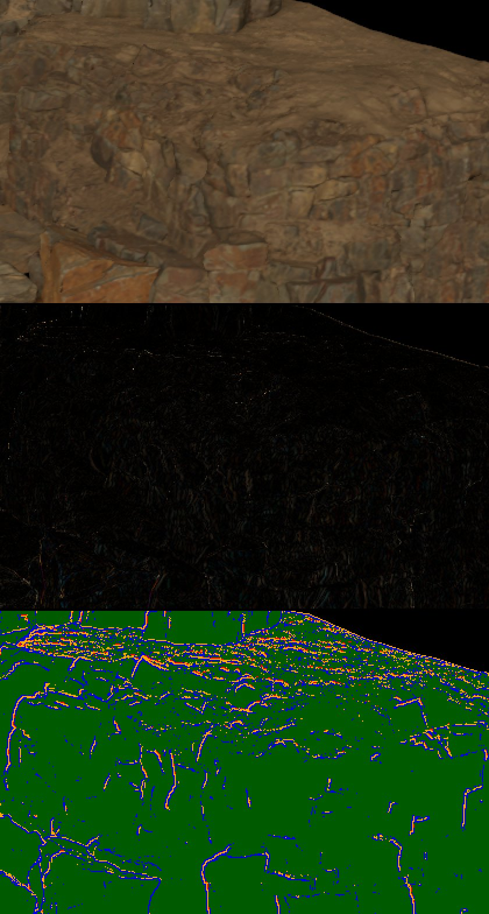

# P-SPLIT: program kernel compile cost, trust policy, crack flashes

Unit P-SPLIT, milestone 8 ([milestone-8.md](milestone-8.md)), 2026-11-11, branch `t3/p-split` from main `c8c7443`. Labels: **M** measured here, **C** read from code, **A** another unit's measurement, **I** inference.

Scope after root's steers: (A) first, the quarry crack flashes P-FLICKER left; (B) the split was time-boxed by P-SKY. P-SKY (#16/#17) cut the game scene's cold first image from about 183 s to about 11 s on both paths (**A**, root), so this unit keeps to the trust-policy fan-out, the two unchecked user-text paths and the census tool. The full kernel split goes ahead only if Showcase through Ara, cold, after P-SKY, still takes over a minute.

## Result

| Step | Result | Verdict |
|---|---|---|
| A. Crack flashes: capture TR1's per-pixel continuation mask | 64% of the >20-code step energy sits on the 13% of quarry pixels where TR1 rejected history taps, all along the scan's crack folds. Bright fresh samples are not the cause: a fresh-sample clamp leaves flicker at 4.32 | **MERGE** the measurement switch (production source unchanged). Fix not attempted, per root's steer: the next flicker unit |
| B1. Trust-policy fan-out | Every program module compiles checked. A source-only edit to a glass program now changes 2 binaries, down from 24 (census) | **MERGE** |
| B2. GI-cell and glass reflected-hit modules compiled program text unchecked | Both now go through the one program-module entry and compile checked | **MERGE** (with B1) |
| Frame-time cost of B1/B2 (quarry, interleaved) | None measurable: RT still 3.01-3.15 vs 3.03-3.19 ms, non-RT still 8.03-8.24 vs 8.17-8.36 ms (checked vs old); HDR 125/125 identical per path | — |
| B3. Census tool (draft PR #11) | Merged in; 1,168 of 1,171 records emitted at 4ae6fdb. Its `program-bins` entry predated main's `PRIMARY_BATCHES` prefix; it now calls `program_lists::bin_source()` (not rebuilt) | **MERGE** after the merge gate reruns it |
| Kernel split | Not started: P-SKY took the cold game scene to about 11 s and Showcase through Ara to 24-25 s (root) | Deferred by root |

No new resource kind, binding shape, texture view, sampler, storage format or device feature. No planner signature or per-frame record changes (`shadow_gpu::plan_frame`, `PostSettings::record`, `prepare_gi` untouched).

## A. Crack flashes

### Measurement switch

`RENDERLAB_P_STILL=tr1-mask|tr1-raw|tr1-window` (src/temporal_reconstruction.rs `mask_resolve`) composes a measurement copy of TR1's resolve. Production compiles `RESOLVE` unchanged; the switch only edits the copy's text. The output's alpha carries how TR1 continued each pixel:

| alpha | meaning |
|---:|---|
| 1 | restart (cut, first frame) |
| 2 | still pixel, own history |
| 3 | moving, Catmull-Rom over 16 accepted taps |
| 4 | moving, bilinear over 4 accepted taps (an outer Catmull-Rom tap failed) |
| 5 | moving, bilinear over 1-3 accepted taps |
| 6 | no accepted tap: spatial start from this frame's 3x3 |
| 7 | rejected by an engine event (moving caster, relit light) |
| +16 | silhouette pixel (two-slot path) |
| 32 | third-surface pixel (state carried) |

`tr1-raw` writes the frame's fresh sample as the colour, `tr1-window` the history weight and window before the sample. `tools/p-flicker/mask.py` finds one-frame spikes (frame t departs from the mean of t-1 and t+1 by more than 20 codes while those two agree within 10) and tabulates the class, history and fresh sample at them.

### Capture (M)

Lease `crack-l1` (65 s), RT, P-FLICKER's clip manifest (walk frames 160-223, every frame captured) with each switch, and the standard yardstick manifest for the score. Binary: release `p_yard_capture` at `1375b18` (c8c7443 plus the switches), SHA-256 `1467b02b…`. The mask switch changes only the output's alpha and adds private writes (C); history targets are production's. The base run scores exactly main's 4.323.

**Where the >20-code steps fall** (P-FLICKER's own residual: frame step minus the reference's step, on the 15 clip pairs that have references; 1,840 such pixels a pair, 25% of the flicker energy, as P-FLICKER measured):

| TR1 class at frame t | share of the quarry's pixels | share of >20-code pixels | share of their energy |
|---|---:|---:|---:|
| Catmull-Rom, all 16 taps accepted | 88% | 45% | 35% |
| bilinear, 4 taps (an outer tap rejected) | 9.5% | 16% | 13% |
| bilinear, 1-3 taps | 3.3% | 34% | 44% |
| spatial start (no tap accepted) | 0.2% | 5% | 7% |

The strict one-frame spikes (86 a frame on the clip) are 75% bilinear 1-3, 20% spatial start, 2% Catmull-Rom. The frame before a spike is also mostly bilinear 1-3 (68%): these pixels sit in partial rejection frame after frame, not once.

**Rejection, not bright samples.**
- The class map (below) lines every crack, ledge and fold of the scan with rejected taps (blue: 4 taps, orange: 1-3, red: none), and the white spike pixels sit on those lines.
- Only 15% of the spikes' fresh samples lie more than 10 codes outside their 8 neighbours' range (0.13% of all pixels do), and the spike's sign follows the sample in 99% of cases. The sample is ordinary texture; what makes it jump is its weight.
- A rejected tap shortens the window: bilinear over the remaining taps keeps T1b's `1 + blur_budget / sum f(1-f)` (about 3-5 frames) and a spatial start at most 4, so each frame's jittered sample, landing on the crack's dark floor or its lit rim, moves the pixel by a third to a quarter of the difference.
- The fresh-sample clamp screen confirms it: clamping the sample to its 8 same-surface neighbours' range scores 4.325 (hard clamp) and 4.319 (range widened by half), against 4.323 unclamped. Neither moves the flicker, and the hard clamp raises still error (6.630 → 6.703) by flattening fine texture.

**Verdict: history rejection, a reconstruction change; not fixed here (root's steer).** The geometric tap test (`tr1_tap`: the previous sample point within four pixel footprints of the current tangent plane) rejects taps across the scan's crack folds, which belong to the same placement and side. That is the next flicker unit. Directions, unmeasured: a tap test that tolerates near-coplanar folds of one mesh (distance along the view ray, or the tap's own plane); or keeping the window when only outer taps fail, renormalising over the accepted ones. Either must keep real disocclusions rejecting, so the S4 door and the silhouette tests gate it.

## B. Trust policy and user-text paths

**C:** before, `program_gpu::module` compiled the exact bundled standard program with the engine API (unchecked) and any other text checked, so the first edit of the standard program changed the check mode of all 24 of its kernels (P-PIPE, census PR #11). GI cell shading (`gi_cache.rs`) and the glass reflected-hit kernel (`transparency_reflection.rs`) compose program text but used the engine API.

Change: every module composed from program text compiles checked: the standard and toon programs, user programs, TP1 glass, GI cell shading and glass reflected hits. They all go through one entry, `PipelineDevice::create_program_module` (src/pipeline_compilation.rs). An edit now recompiles only the kernels whose text it changes. A measurement switch, `RENDERLAB_P_SPLIT_STANDARD_UNCHECKED`, restores the old standard-program policy for A/Bs.

**Frame time (M).** Lease `split-l2`, quarry yardstick at 1080p, one binary (`4ae6fdb`, `p_yard_capture` SHA-256 `3211a659…`), four interleaved visits per path (old policy, checked, old, checked). GPU span p50 in ms, with the ratio to Unreal Epic (HW Lumen 4.50 / 4.57 / 4.52 ms; SW Lumen 4.02 / 4.12 / 4.11):

| | old policy (2 visits) | checked (2 visits) | checked vs Epic |
|---|---|---|---|
| RT still | 3.19 / 3.03 | 3.15 / 3.01 | 1.43-1.49x faster |
| RT moving | 3.96 / 3.98 | 3.95 / 3.96 | 1.15-1.16x faster |
| RT cut | 12.28 / 12.39 | 12.38 / 12.36 | 2.7x slower |
| non-RT still | 8.36 / 8.17 | 8.24 / 8.03 | 2.0-2.05x slower |
| non-RT moving | 10.44 / 10.33 | 10.30 / 10.22 | 2.5x slower |
| non-RT cut | 42.74 / 44.34 | 42.77 / 43.97 | 10.4-10.7x slower |

The checked kernels are within visit-to-visit noise of the unchecked ones, and if anything faster. The image is unchanged in principle: runtime checks change results only on out-of-range accesses (C). HDR identity: root compared this lease's `idu`/`idc` captures before they were cleared: 125 of 125 frames identical on each path (docs/m7-gaps.md, "M8 P-SPLIT parked").

## Census (M)

The census tool from draft PR #11 is merged in, conflict-resolved against main (`visibility_buffer.rs`). Its catalogue now records the checked API for every program-composed module, GI cell and glass reflection included. Run inside `split-l2` on `4ae6fdb` (after P-SKY): 1,168 records, 3 failures. The failures are all the same stale entry: `program-bins` included `program_bins.wgsl` raw, but main now prepends `const PRIMARY_BATCHES` in `program_lists::bin_source`. The catalogue now calls that composer; this and the later merge of main were not rebuilt in this unit, so the merge gate reruns the census.

| Default policy, user edit | Before (PR #11, main ff19aef) | After (this branch) |
|---|---:|---:|
| standard → glass tint: binaries changed | 24 (2 from the edit, 22 from the check-mode switch) | **2** (the two `fs_transparent`) |
| standard → toon: binaries changed | 39 of 193, 4 removed | 39 of 192, 4 removed |
| largest program kernel (non-RT list, soft, streamed, checked) | 232,912 B | 225,764 B (after P-SKY) |

## Cold start (M)

`game_scene` (1280x720, two frames), candidate `4ae6fdb`, one compile in flight, fresh NVIDIA and application caches for cold, profiled (`RENDERLAB_STARTUP_PROFILE`):

| Game scene | Cold first image | Warm | Peak private (cold) | Program kernels (cold) | All other pipelines |
|---|---:|---:|---:|---|---:|
| RT | 10.9 s | 0.88 s | 1.25 GB | 2.7 s + 1.5 s | 5.7 s (64) |
| non-RT | 9.9 s | 0.90 s | 1.97 GB | 2.3 s + 1.3 s | 5.5 s (94) |

Against P-PIPE (main before P-SKY): 143 / 125 s cold and 5.2-6.1 GB peak; the standard program's list kernel took 91-96 s. P-SKY did that (root measured it at about 11 s too); checked compilation does not add measurably. Showcase through Ara after P-SKY: 25 s RT, 24 s non-RT cold, including settle and 60 frames (root's measurement; not rerun here). A start after a kill was not measured on this base.

## Hardware, build, process

- RTX 4070 SUPER, NVIDIA 617.14, Ryzen 7 7800X3D, 32 GB, Windows 11 Pro 26300. Release builds, two Cargo jobs; lib tests dev profile.
- Binaries: crack lease `1375b18` (SHA-256 `1467b02b…`, 179 s build); A/B lease `4ae6fdb` (`p_yard_capture` `3211a659…` and `game_scene`, 55 s); lib test binary at `4ae6fdb` (176 s). Lib tests in `split-l2`: **209 passed, 0 failed, 168 ignored**.
- Leases (n8-run, `--quarry-lease`): `crack-l1` 65 s, `split-l2` 296 s. Free RAM at their starts: 16-18 GiB.
- Time: the unit started at 00:00 UTC. About 3 h 30 min went to the GPU and build queue (ara-integration and root's P-SKY checks went first by order). Implementation and analysis took about 1 h 30 min; GPU time was about 6 min.
- Cleanup: raw HDR dumps and the Cargo target deleted; `D:/Coding/renderlab-work/p-split` keeps logs, JSON summaries, the census `results.json` and the mask PNGs.
