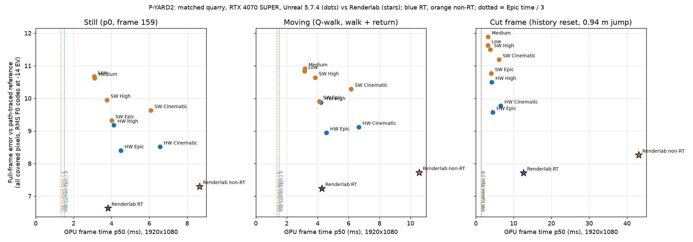

# P-YARD: full-frame yardstick against Unreal (Lumen + TSR)

## P-YARD2 result (2026-11-10, branch `t3/p-yard2` on main `71ea355`)

Measurement unit; no renderer source edits (the release adapter `examples/p_yard_capture.rs` and `tools/p-yard/` are new measurement code only).

**Headline.** On the matched quarry at 1080p, Renderlab's image is closer to the path-traced reference than every Unreal preset, on both paths, still, moving and on the cut. Speed is far from the 3x target. RT is at parity with HW Lumen Epic: 1.18x faster still, 1.07x faster moving, 2.8x slower on the cut frame. Non-RT is 2.2-2.6x *slower* than SW Lumen Epic, and 10x slower on the cut. In motion, Renderlab also shows more frame-to-frame noise than Unreal: flicker is 4.39 against 3.68 codes on the quarry, and heavy grain shows on flat walls in the dim S4 interior. That grain is the most visible remaining loss.

| Path | State | Renderlab ms | Unreal Epic ms | Speed vs Epic | 3x target ms | Renderlab error | Unreal Epic error | Best Unreal error (preset, ms) |
|---|---|---:|---:|---:|---:|---:|---:|---|
| RT (vs HW Lumen Epic) | still | 3.82 | 4.50 | 1.18x faster | 1.50 | **6.63** | 8.39 | 8.39 (Epic, 4.50) |
| RT | moving | 4.26 | 4.57 | 1.07x faster | 1.52 | **7.24** | 8.94 | 8.94 (Epic) |
| RT | cut frame | 12.60 | 4.52 | 2.8x slower | 1.51 | **7.71** | 9.57 | 9.57 (Epic) |
| RT | after cut (31 frames) | 3.53 | 4.48 | 1.27x faster | 1.49 | **6.94** | 9.07 | 9.07 (Epic) |
| non-RT (vs SW Lumen Epic) | still | 8.65 | 4.02 | 2.15x slower | 1.34 | **7.30** | 9.32 | 9.32 (Epic, 4.02) |
| non-RT | moving | 10.57 | 4.12 | 2.57x slower | 1.37 | **7.72** | 9.90 | 9.90 (Epic) |
| non-RT | cut frame | 43.11 | 4.11 | 10.5x slower | 1.37 | **8.26** | 10.76 | 10.76 (Epic) |
| non-RT | after cut | 8.71 | 4.04 | 2.16x slower | 1.35 | **7.53** | 10.34 | 10.34 (Epic) |

Error is the full-frame RMS (all covered pixels) in F0 codes at -14 EV against the path-traced reference (lower is better). Times are GPU frame-time p50 over two processes per configuration. On the cut frame they are the median of the two single observations.

- **Where Renderlab sits against "Unreal's image at about 3x its speed".** Quality is met on both paths, by 19-23% lower full-frame error and 25-35% lower at +4 stops. Speed is not: RT needs about 2.5x more speed (2.8x moving), and non-RT about 6.5-7.7x. The cut frame is the worst case on both paths (8x and 31x off the target).
- **Against the reference, Renderlab non-RT (7.30) beats Unreal's best RT preset** (HW Cinematic 8.51, HW Epic 8.39), still and moving.
- **Unreal flaws beaten:**
  - SW Lumen leaks sun through S4's 1 mm and 5 mm walls; the interior turns near-white. Renderlab and HW Lumen don't.
  - SW Lumen's S5 mirror shows repeated striped rooms and a distorted cube. Renderlab's mirror is clean on both paths.
  - Unreal's quarry is softer and flatter in texture and colour.
  - Neither engine leaves a visible ghost trail behind the sliding door or in the mirror. Unreal's door edge shows a faint doubled strip mid-slide (frame 76).
- **Losses to Unreal** (ranked in [m7-gaps.md](m7-gaps.md#m8-unreal-yardstick-p-yard2-2026-11-10)): motion flicker and flat-surface grain; non-RT frame cost; the cut-frame spike; lifted narrow-crevice occlusion; stray bright pixels on a moving edge and revealed ground; cut-frame edges (14.72 against 14.28).



Data: [p-yard/yardstick.csv](p-yard/yardstick.csv) (40 rows: 10 configurations × still/moving/cut/recover, with +4-stop error, the background-inclusive `image` RMS, edge RMS and flicker).

### Full table (all presets)

| Configuration | Path | Still ms / err | Moving ms / err / flicker | Cut ms / err | Edge err moving | err L4 still |
|---|---|---|---|---|---:|---:|
| **Renderlab RT** | RT | 3.82 / **6.63** | 4.26 / **7.24** / 4.39 | 12.60 / **7.71** | 11.56 | 8.74 |
| **Renderlab non-RT** | non-RT | 8.65 / **7.30** | 10.57 / **7.72** / 4.44 | 43.11 / **8.26** | 11.95 | 9.33 |
| UE HW Lumen High | RT | 4.13 / 9.18 | 4.22 / 9.87 / 3.78 | 4.25 / 10.49 | 12.97 | 13.07 |
| UE HW Lumen Epic | RT | 4.50 / 8.39 | 4.57 / 8.94 / 3.68 | 4.52 / 9.57 | 12.21 | 11.62 |
| UE HW Lumen Cinematic | RT | 6.58 / 8.51 | 6.67 / 9.11 / 3.66 | 6.62 / 9.77 | 11.71 | 12.09 |
| UE Low (Lumen not active) | non-RT | 3.10 / 10.67 | 3.17 / 10.83 / 3.34 | 3.23 / 11.62 | 16.27 | 15.00 |
| UE Medium (Lumen not active) | non-RT | 3.12 / 10.62 | 3.18 / 10.91 / 3.37 | 3.28 / 11.88 | 16.80 | 15.21 |
| UE SW Lumen High | non-RT | 3.77 / 9.94 | 3.85 / 10.63 / 3.79 | 3.87 / 11.49 | 14.98 | 15.04 |
| UE SW Lumen Epic | non-RT | 4.02 / 9.32 | 4.12 / 9.90 / 3.69 | 4.11 / 10.76 | 14.65 | 14.00 |
| UE SW Lumen Cinematic | non-RT | 6.09 / 9.63 | 6.17 / 10.28 / 3.66 | 6.17 / 11.19 | 14.79 | 14.61 |

Flicker is the frame-to-frame step minus the reference's own step on consecutive moving frames (U0b's residual, all covered pixels, codes). Lower is steadier. Low and Medium flicker least because they have no Lumen probe noise to flicker.

### Manifest and states (`tools/p-yard/manifest.json`)

One frame list per scene that both engines replay frame for frame (Unreal CSV frame *i* is Renderlab frame *i*). `tools/p-yard/manifest.py` regenerates it; each pose is copied bit for bit from the registered sources, so U0b's references match by exact camera key.

| Frames | State | Content |
|---|---|---|
| 0-95 | warm | p0 still (Unreal's DumpCVars at 40/95 and ProfileGPU at 64 happen here) |
| 96-159 | **still** | p0 still; frame 159 is scored (4,096-spp reference) |
| 160-223 / 256-319 | **moving** | registered Q-walk frames 1-64 and 97-160: 1 cm and 0.05° yaw per frame; 60 frames with references (1,024 spp) |
| 224-255 | hold | Q-walk 65-96, held at the walk's end (32 scored frames) |
| 320 | **cut** | history reset (`r.ResetViewState` / `Engine::cut()`) and a 0.94 m sideways jump to `q-disocclusion-047` |
| 321-351 | recover | held at the cut pose; 31 scored frames |

The S4 door is viewed from inside, facing the sliding door, with the sunlit exterior revealed behind it (eye (-0.3, 1.3, -1.2), target (1.0, 1.0, 2.0)). The door slides 1 m over frames 32-96. S5 keeps its registered corner pose; the cube moves 0.3 m over frames 32-128 and is visible only in the mirror.

### Method, settings, versions

- **Hardware.** RTX 4070 SUPER 12,282 MiB, NVIDIA 617.14, Ryzen 7 7800X3D, Windows 11 Pro 26300. Native 1920×1080, no upscaling on either engine.
- **Unreal.** UE 5.7.4 CL51494982, packaged Development, D3D12 SM6, `-RenderOffscreen`, hidden.
  - Quarry: U0's Lumen-capable package (`E:/renderlab-work/m7-u0/ue-package`, executable `69d6f88a…a6e5`). Benches: U0b's package.
  - Settings are U0's (`scripts/m7-u0-ue.py`): manual -14 EV with `r.EyeAdaptation.PreExposureOverride 0`; TSR Epic at 100% with 200% history; VSM SMRT 8×8 for SW/Low/Medium, HRT for HW; `r.MaxAnisotropy 16`; Nanite RT mode 1. Presets are the GI and reflection scalability groups at level N.
  - Low/Medium: groups 0/1, which disallow Lumen (`r.Lumen.DiffuseIndirect.Allow 0`, `r.Lumen.Reflections.Allow 0`, `r.DynamicGlobalIlluminationMethod 0`). The matched project's SystemSettings pin DFAO and SSR off, so each group's own value is restored at console priority: Low has DFAO 0 and no reflection method; Medium has DFAO 1, SSR quality 2 and `r.ReflectionMethod 2`.
  - Every run passed `DumpCVars` readback against `BaseScalability.ini`. The effective tracing mode came from RDG pass names (software / hardware / lumen off, as requested). The per-frame camera readback passed for frames 159-351 of every quarry run (1e-6 m). Frame brightness matched U0's (means 12.05/255 for HW Epic and 12.12/255 for SW Epic; Low 10.55/255 because its preset scales the sky light by 0.8).
- **Renderlab.** Main `71ea355`, release build of `examples/p_yard_capture.rs` (rustc 1.96.0, binary `c8fb1a1d…f003`, renderer source clean).
  - It uses the public `Engine` with shipping defaults: GI, TR1 at native resolution, traced reflections, 128 local shadows, `Quality::Realtime`. The matched content has no medium, so `aerial_perspective`, `height_fog` and `volumetric_fog` are off.
  - Lighting: `Sky::Map` with `sun128.rle2` at intensity 1 and a black background; sun travel (-0.4, -0.8, -0.3), 1000/950/850 lux, 0.04 rad radius; anisotropy 16.
  - The Vulkan validation layer that n8-run injects is stripped for these runs. The loaded scene has 13,034,903 triangles on both paths, the reference's count.
- **Timing.** Unreal: CSV `GPUTime` (`-csvGpuStats`). Renderlab: `GpuSample.render_span` (GPU timestamps, first pass to present end), one frame in flight. Both are GPU frame spans of the same frames.
  - Two processes per configuration (Unreal visits 0 and 1, Renderlab visits 0 and 1). Unreal visit spreads are ≤0.04 ms. Renderlab RT still visits were 3.33 and 4.30 ms (one process bimodal, likely wallpaper contention); its moving, cut and recover visits agree within 0.08 ms.
  - Unreal's numbers reproduce U0b's quiet campaign: HW Epic 4.50 against 4.45-4.53, SW Epic 4.02 against 4.00-4.05.
  - These were not quiet-window claims: the wallpaper was not paused, and other units' CPU work overlapped some runs.
- **Error.** U0b's protocol (`scripts/m7-u0b-score.py`): the pre-tonemap HDR each engine hands its tone mapper (Unreal: the Tonemap input after TSR, decoded from `DumpGPU` with the exposure proven per frame; Renderlab: the HDR target after TR1, `try_capture_hdr`), divided by the pre-exposure (2^-14 on both), through the frozen F0 Reinhard/sRGB transform at -14 EV (L0) and +4 stops (L4), against the reference mean.
  - "Full frame" is every covered pixel. The background-inclusive `image` RMS is in the CSV.
  - The scorer reproduces U0b's recorded HW Epic static floor exactly (8.410 / 11.650; edge, occluded and silhouette match). This run's own HW Epic still frame scores 8.394.
- **Reference check (item 4).** All 32 path-traced references used are U0b's `quarry-final` archives: `quarry-p0` at 4,096 spp, plus the Q-walk witnesses and `q-disocclusion-047` at 1,024 spp.
  - Archive hashes verify, and each records the current asset (`1ce53c38…`) and environment (`3ccd61b1…`) hashes and a black primary background.
  - The current base loads the same triangle count. Scene identity holds, so no reference was regenerated (`reference-identity.json`).
- **GPU use.** 6 leases through `scripts/n8-run.py`, about 23 minutes in all:
  - `pyard2-rl1` 527 s, Renderlab;
  - `uet0`, stopped by the UE guard when ara-vk's `ara-shader-cook.exe` started (no data, rerun);
  - `uet0b` 64 s, Unreal timing;
  - `uec1` and `uec2`, 206 + 174 s, quarry captures;
  - `ueb1` 413 s, timing visit 1 and benches.

  There was one build: 167 s, build slot plus stillkit mutex, after p-defect and Ara work.

### Crop sheets (inspected by eye)

Full-size sheets are in `D:/Coding/renderlab-work/p-yard2/sheets/`: `quarry-full.png`, `quarry-crop-a/b.png`, `quarry-cut-zoom.png`, `s4-door.png`, `s4-door-edge-zoom.png`, `s4-full-88.png` and `s5-cube.png`. Reduced copies are in [p-yard/](p-yard/).

- **Quarry, still/walk/cut** ([quarry-full](p-yard/quarry-full.jpg), [cut zoom](p-yard/quarry-cut-zoom.jpg)). Every configuration renders the same pose and geometry.
  - Renderlab (both paths) has the reference's texture detail and warm saturation; Unreal is softer and flatter, with SW the flattest.
  - The deep crevice in the cut view is near-black in the reference. HW Cinematic is the closest; Renderlab RT and non-RT show it lifted (lit grey stone); SW Lumen lifts it most.
  - No engine shows a visible cold-history artefact on the cut frame or the next frame at display scale. Renderlab's cut-frame edge error is slightly above HW Epic's (14.72 against 14.28).
- **S4 door** ([sheet](p-yard/s4-door.jpg), [frame 88](p-yard/s4-door-frame88.jpg)). No reference exists for this view.
  - Renderlab and HW Lumen agree on the interior's brightness, and SW Lumen leaks.
  - Renderlab shows heavy blotchy grain on every flat wall and the door on both paths. Non-RT is worse, and the grain is still visible 15 frames after the door stops. Unreal HW is smooth.
  - Renderlab RT shows stray bright pixels along the moving door edge (frames 64 and 76) and speckles on the newly revealed shadowed ground outside.
  - Neither engine trails the door into the revealed region.
- **S5 mirror** ([sheet](p-yard/s5-cube.jpg)). Renderlab and HW Lumen reflect the room and cube cleanly with no visible lag; SW Lumen's mirror is broken. Renderlab's walls read slightly cooler than Unreal's.

### Reproduction

```
py -3 -B tools/p-yard/manifest.py                         # shared manifest (CPU)
py -3 -B tools/p-yard/host.py build                       # release adapter: build slot + stillkit mutex, after admission
py -3 -B tools/p-yard/host.py lease LABEL 15 -- py -3 -B tools/p-yard/rl.py quarry:capture:rt quarry:timing:rt:0 ...
py -3 -B tools/p-yard/host.py lease LABEL 15 -- py -3 -B tools/p-yard/ue.py timing|capture quarry [CONFIGS] [--visit N]
py -3 -B tools/p-yard/ue.py decode quarry|s4-door|s5-cube # CPU, after the lease
py -3 -B tools/p-yard/score.py identity|quality|timing|chart|sheets
```

Evidence: `D:/Coding/renderlab-work/p-yard2/` holds `quality.json` (every frame, 8 populations, both exposures), `timing.json` (every frame's GPU time), `yardstick.csv/png`, `reference-identity.json`, Unreal readbacks/logs/natives, Renderlab `engine.json`, lease logs and sheets. Raw Unreal dumps over 5 MB were deleted by the decoder, and the Renderlab raw HDR readbacks (16.6 MB each) after scoring. The Cargo target and the temporary Unreal macro files on E: were removed. The bench Tonemap dumps lose the frame whose `HighResShot` fires (CSV 72), so those natives are indexed by engine frame. The log's own mover line gives the offset (engine = CSV + 1).

## P-YARD (parked, earlier the same day)

Milestone 8 measurement unit, branch `t3/p-yard` on main `a807b01`, 2026-11-10. No renderer code changes.

**Status: parked by root order before any GPU or build work** ("Showcase profiling for Ara comes first, so PARK P-YARD now"). The unit stopped during the reading phase. No build slot, GPU lease, Cargo target, capture or dump was taken or created, so nothing needed cleaning up. Nothing below is a new measurement: every number is quoted from the earlier docs named next to it.

## Goal (unchanged, for the resume)

One matched scene; still, fixed-path motion and a camera cut; Renderlab RT and non-RT against Unreal at Low/Medium/High/Epic/Cinematic on Lumen HW and Lumen SW (D3D12 SM6); the same resolution and GPU frame-time method for both engines; a high-sample path-traced reference; full-frame error per configuration and state; an error-vs-ms chart (PNG + CSV); eye-judged crop sheets of Unreal's known flaws (ghosting, disocclusion trails); and a per-path, per-state position against "Unreal's image at about 3x its speed", with a ranked gap list for `docs/m7-gaps.md`.

## Stopped at

The reading phase was done: AGENTS.md, `docs/milestone-8.md`, `docs/m7-ara1-plan.md`, `docs/m7-u0.md` in full, `docs/m7-u0b.md` (summary, references, floors) and the six named memories. Not yet read: `docs/m7-u1*.md` beyond their summaries, `docs/ue-sky.md`, `docs/quarry-end-to-end-comparison.md`, `docs/unreal-comparison-setup.md`, `docs/unreal-quarry-full-detail-comparison.md`, `docs/m7-ara1-report.md`, `docs/m7-gaps.md`.

## What exists and can be reused

**Scene choice: use the quarry.** It is the only scene with a matched Unreal project, Lumen-capable cooked packages and 1080p path-traced references. The ARA1 scenes (game-base, Ara PBR) have **no Unreal port**. Porting one would cost an import, a cook and a lighting match, which is most of the time box.

| Asset | Location | Notes |
|---|---|---|
| Matched UE quarry project, e2e launches | `D:/Coding/renderlab-work/ue-m5/Quarry` (`launches/e2e-matched-s3-*/process.json` hold the command lines) | Original matched package. It has **no mesh distance fields**, so software Lumen cannot run on it. |
| Lumen-capable quarry package (DF + path tracer) | `E:/renderlab-work/m7-u0/ue-package`, project copy `E:/renderlab-work/m7-u0/ue-project` | Cooked by U0 with `r.GenerateMeshDistanceFields=True`, `r.DistanceFields.SupportEvenIfHardwareRayTracingSupported=1`, `r.PathTracing=True`. UE 5.7.4 CL51494982, packaged Development, D3D12 SM6, `-RenderOffscreen`, hidden. |
| UE bench package (SV, S4, S5, S2G) | `E:/renderlab-work/m7-u0b/ue-package` | `/Game/M7U0b/{SV,S4,S5,S2G}/Bench` |
| UE configuration study driver | `scripts/m7-u0-ue.py` (`study`, `summarize`; `BASE_COMMANDS`) | Proves every run's settings by `DumpCVars` against `BaseScalability.ini`, and reads the tracing mode from RDG pass names. It already has static, camera-alternation, pan (2 cm/frame, captures at 97/112/128/159), sun-step and sky-yaw workloads. |
| U0b quiet timing and floor runs | `scripts/m7-u0b.py`, `m7-u0b-score.py`, `m7-u0b-report.py`; evidence under `E:/renderlab-work/m7-u0b` | 80-process static/camera/sun quiet campaign. The cut clears TSR history through the camera-cut flag and keeps Lumen's world state. |
| Shadow-only UE timing | `scripts/ue-shadow-motion.py` | See the memory `unreal-shadow-cost-measured`. |
| UE memory | memory `memory-budget-vs-unreal` | `GPUMem/LocalUsedMB` CSV column. |
| 1080p quarry path-traced references | `E:/renderlab-work/m7-u0b/reference/quarry-final` (`reference-coverage.json`) | `renderlab::reference` with full 13.0M triangles, textures and the RLE2 environment. quarry-p0/p1 (± sky-only) at 4,096 spp have a median relative noise of about 0.29% and take about 22 s per call. There are 123 archives across 162 rows, including motion/disocclusion states. **Their content identity must be rechecked against the current base before scoring** (memory `check-evidence-binary-base`). |
| Reference tracer validation | `docs/m7-u0.md` §2, `docs/m7-u0b.md` | Analytic gates and Mitsuba 3.9.1 cross-checks pass. **Recorded choice for this unit: Renderlab's reference tracer.** It already renders the matched quarry; UE's path tracer was only timed in U0 (about 7.6 ms per 1-spp frame). |
| Renderlab-side scoreboard | `tools/ara1/` (`images.py compose/score`, `lease.py`) and `scripts/n8-quarry-score.py` | `images.py score` reuses `scan-quality-compare.py` linear/statistics. Swap the Ara column for UE. |

**Unreal numbers already measured** (quarry, 1080p, RTX 4070 SUPER, NVIDIA 617.14, `docs/m7-u0.md` study/c, contended block; U0b's quiet campaign refines them):

| Config | Static GPU p50 (ms) | LocalUsed MiB |
|---|---:|---:|
| TSR only, VSM | 3.12 | 4,293 |
| SW Lumen High | 3.77 | 5,038 |
| SW Lumen Epic (non-RT floor) | 4.04 | 5,142 |
| SW Lumen Cinematic | 6.46 | 5,409 |
| HW Lumen High | 4.13 | 6,211 |
| HW Lumen Epic (RT floor) | 4.69 | 6,444 |
| HW Lumen Cinematic (+ hit lighting) | 6.72 (6.68) | 6,578 |

U0b's clean HW Epic visits range from 4.45 to 4.55 ms. Camera motion showed no systematic Unreal cost. On a 2 cm/frame pan, U0 saw no visible trails or ghosting at display scale on this scene. **So the quarry's slow pans may not show Unreal's ghosting at all.** The ghosting crops probably need a mover or a fast-disocclusion path; the S4 door and S5 cube benches already exist in the UE bench package.

**Error against reference already measured for UE** (`docs/m7-u0b.md`, frame population, G1 sky-visibility study): SW Epic with global DF 35.9%/68.3%, SW Epic with mesh SDF 38.9%/87.2%, HW Epic 10.7%/11.2%. This is a population metric for one effect, not the full-frame displayed error this unit needs.

## Gaps in existing coverage (this is the unit's actual work)

1. **Low and Medium presets were never run.** At those GI levels UE turns Lumen off (no GI, or SSGI and screen-space reflections), so "Lumen HW vs SW" does not apply there. Record them as single rows marked "Lumen not active", read back with `DumpCVars`.
2. **No full-frame displayed-error score** for any UE preset against the quarry reference, in any state.
3. **No current-base Renderlab row** on the same quarry poses, path, cut and timing method. GPU frame time for both engines: UE CSV `GPUTime`; Renderlab `render_span` from the ARA1 adapter.
4. **No error-vs-ms chart or CSV.**
5. **No eye-judged ghosting/disocclusion crop sheets** for UE versus Renderlab.

## Next step (resume plan)

1. Read the remaining docs listed in "Stopped at", especially `m7-ara1-report.md` and `m7-gaps.md`, so known gaps are not duplicated.
2. On CPU: check that the U0 package's quarry poses match `quarry-final`'s scene identity. Write `tools/p-yard/` with a manifest of poses, the pan path and the cut frame shared by both engines; a UE wrapper over `m7-u0-ue.py study` for the preset × {HW, SW} × {static, pan, cut} matrix; and a scorer and plotter over `tools/ara1/images.py score`.
3. GPU, through `scripts/n8-run.py` in leases of at most 15 minutes, after the Ara PR gate, the Ara integration thread and P-PREVIEW: (a) a 2-launch UE smoke checking frame brightness (pre-exposure override 0); (b) the UE matrix (about 10 configs × 3 states, at about 10 s per run, fits in 1-2 leases); (c) Renderlab RT and non-RT on the same poses with a release binary; (d) references for any pan or cut frame not covered by `quarry-final`, at 4,096 spp and about 22 s each.
4. Score, plot, inspect crops (white pixels, noise, aliasing and trails, in motion and on the cut), write the per-path, per-state verdict and add the ranked gaps to `docs/m7-gaps.md`.

**Estimated remaining effort:** about 3 hours, including roughly 30-40 minutes of GPU lease time.
